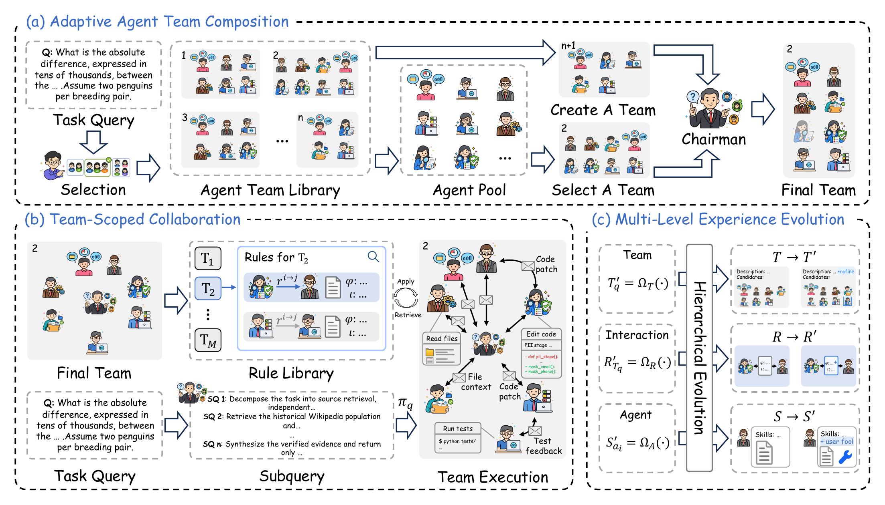

# EvoTeam: Multi-Agent Collaboration via Evolving Teams

This repository is the implementation of **EvoTeam**, a framework for
multi-agent collaboration through evolving teams.

EvoTeam maintains a reusable agent pool, selects or composes a task-specific
team, and uses execution evidence to evolve team organization, handoff rules,
and reusable agent experience. 

## Overview

<p align="center">
  
</p>

| Module | Role |
|---|---|
| Adaptive Agent Team Composition | Select a reusable team or compose a provisional team from the shared agent pool. |
| Team-Scoped Collaboration | Apply the selected team's handoff rules during task execution. |
| Multi-Level Experience Evolution | Update team templates, candidate rosters, handoff rules, and reusable agent skills from task evidence. |

Team collaboration experience remains scoped to its team, while individual
skills can be reused across teams.

## Installation

Requirements:

- Python 3.10 or newer
- Docker for BeyondSWE tasks
- An OpenAI-compatible or otherwise supported LLM endpoint
- The benchmark assets described in [Data Preparation](#data-preparation)

Install EvoTeam in a virtual environment:

```bash
python3 -m venv .venv
source .venv/bin/activate
python3 -m pip install --upgrade pip
python3 -m pip install -e .
cp .env.example .env
```

See [`docs/setup.md`](docs/setup.md) for installation and configuration of
external tools and benchmark environments.

## Configuration

Set the model endpoint in `.env`:

```dotenv
LLM_PROVIDER=dev
DEV_API_BASE=https://your-openai-compatible-endpoint/v1
DEV_API_KEY=your-api-key
EVOTEAM_MODEL=your-model-id
```

For Mixed-Benchmark, the shared evolving pool is configured in
`agents/pool_EvoTeam/pool.yaml`. Individual-benchmark runs use the corresponding
initial pool under `agents/`. Agent model settings are stored in each agent's
`config.yaml`. Keep API keys, datasets, caches, and run outputs out of version
control.

For an alternate environment file:

```bash
export EVOTEAM_ENV_FILE="/absolute/path/to/evoteam.env"
```

## Data Preparation

Prepare the official benchmark data and evaluation environments separately.
The current experiment uses the following evolution/holdout split:

| Benchmark / track | Evolution | Holdout |
|---|---:|---:|
| GAIA | 20 | 100 |
| LoCoBench FI | 20 | 80 |
| LoCoBench CR | 20 | 80 |
| LOCA-Bench | 16 | 240 |
| BeyondSWE CrossRepo | 20 | 180 |
| BeyondSWE DepMigrate | 20 | 158 |
| **Total mixed stream** | **116** | **838** |

Official sources:

- [GAIA](https://huggingface.co/datasets/gaia-benchmark/GAIA)
- [LoCoBench](https://github.com/SalesforceAIResearch/LoCoBench)
- [LOCA-Bench](https://github.com/hkust-nlp/LOCA-Bench)
- [BeyondSWE](https://github.com/AweAI-Team/BeyondSWE)

By default, assets are resolved relative to the repository root. To keep large
datasets outside the repository, preserve the expected `data/` and
`benchmarks/` layout under an external directory:

```bash
export MIXED_DATA_ROOT="/absolute/path/to/external-assets"
export BEYONDSWE_DATA_FILE="/absolute/path/to/beyondswe.jsonl"
```

The external data directory must preserve the required `data/` and
`benchmarks/` structure.

## Evolution and Evaluation

The experimental lifecycle is:

```text
Evolve -> Freeze -> Evaluate
```

### Individual-Benchmark

Each native adapter can be run independently with its own `--split`, resource
limits, and native evaluator. For example:

```bash
python3 -m benchmarks.mixed_native.gaia_backend \
  --split train_20 --evolve --run-id gaia_evolution_evolve

scripts/freeze_team.sh gaia_evolution_evolve latest pool_GAIA_frozen

python3 -m benchmarks.mixed_native.gaia_backend \
  --split test_100 --team pool_GAIA_frozen \
  --run-id gaia_test --rollout 3
```

The freeze step copies the final evolved version from `runs/` into an
independent team directory under `agents/`; `--team pool_GAIA_frozen` then
ensures that evaluation uses the evolved team rather than the initial pool.
Use the corresponding adapter module and frozen team name for LoCoBench,
LOCA-Bench, or BeyondSWE, and inspect each adapter's `--help` output for valid
benchmark-specific splits.
The adapters default to the corresponding initial pools:
`pool_GAIA_pool`, `pool_LoCoBench`, `pool_LOCAbench`, and `pool_BeyondSWE`.

### Mixed-Benchmark

The official manifests fix task membership and order:

- Evolution: `benchmarks/MIXED-BENCHMARK/manifests/mixed_benchmark_official_116_seed20260828.json`
- Holdout: `benchmarks/MIXED-BENCHMARK/manifests/mixed_benchmark_official_116_plus_838_test_seed20260828.json`

Validate and run the shared evolution stream:

```bash
python3 benchmarks/MIXED-BENCHMARK/validate_manifest.py \
  benchmarks/MIXED-BENCHMARK/manifests/mixed_benchmark_official_116_seed20260828.json

python3 benchmarks/MIXED-BENCHMARK/mixed_scheduler.py \
  --manifest benchmarks/MIXED-BENCHMARK/manifests/mixed_benchmark_official_116_seed20260828.json \
  --phase evolve --run-id <evolution_run_id>
```

Freeze the final team and evaluate it on the disjoint holdout:

```bash
scripts/freeze_team.sh <evolution_run_id>

python3 benchmarks/MIXED-BENCHMARK/mixed_scheduler.py \
  --manifest benchmarks/MIXED-BENCHMARK/manifests/mixed_benchmark_official_116_plus_838_test_seed20260828.json \
  --phase test --team pool_EvoTeam_frozen --run-id <test_run_id> --rollout 3

python3 scripts/aggregate_avg3.py \
  <test_run_id>_r1 <test_run_id>_r2 <test_run_id>_r3
```

Evaluation summaries report the six benchmark tracks separately. LoCoBench FI
and CR use continuous LCBS (0–5) as their primary score: `primary_score` in
scheduler summaries and `avg_at_k_primary_score` in the aggregation script.
Native-score fields retain the adapter's normalized score; success rates are
auxiliary statistics. Avg@3 includes a task only when all three rollouts have
eligible results and reports coverage for incomplete runs.

## Project Structure

```text
EvoTeam/
├── agents/
│   ├── pool_EvoTeam/          # Shared evolving pool for Mixed-Benchmark
│   ├── pool_GAIA_pool/        # GAIA initial pool
│   ├── pool_LoCoBench/        # LoCoBench initial pool
│   ├── pool_LOCAbench/        # LOCA-Bench initial pool
│   └── pool_BeyondSWE/        # BeyondSWE initial pool
├── core/                      # Runtime, team formation, and evolution
├── benchmarks/                # Native adapters and mixed scheduler
├── prompts/                   # Bootstrap and reflection prompts
├── scripts/                   # Manifest, freeze, and aggregation utilities
├── assets/                    # Framework figure
├── tests/                     # Structural and behavior checks
├── runtime_pool.py            # Runtime pool entry point
├── pyproject.toml             # Package metadata and dependencies
└── README.md
```

## Citation

If you use this code, please cite the accompanying EvoTeam paper:

```text
EvoTeam: Multi-Agent Collaboration via Evolving Teams.
```

## Acknowledgements

We thank the maintainers of GAIA, LoCoBench, LOCA-Bench, and BeyondSWE for
releasing the benchmark datasets and evaluation environments.
